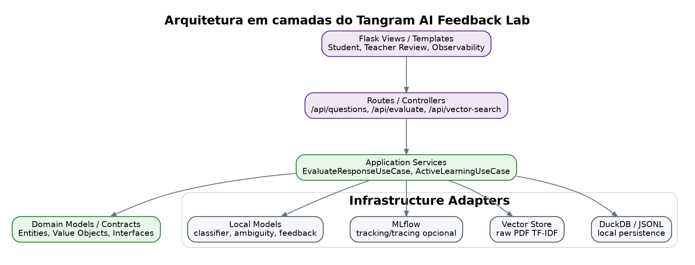
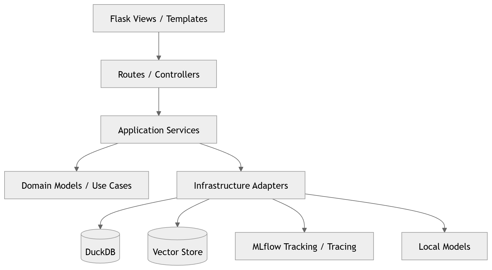
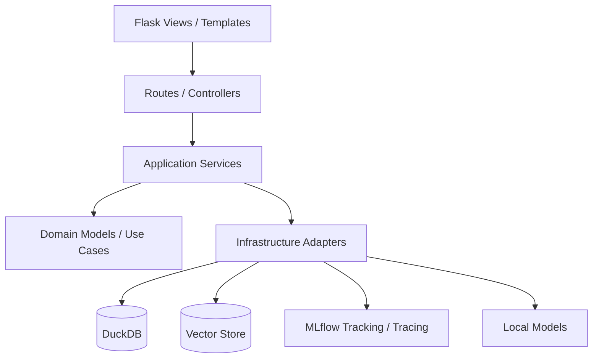
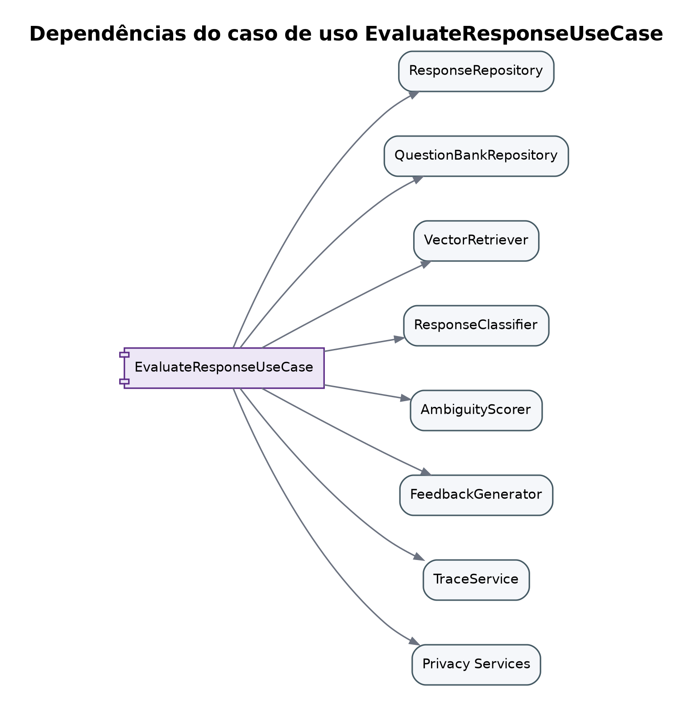
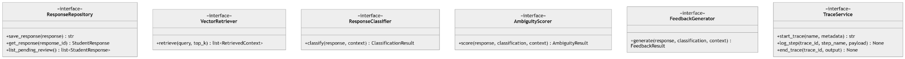
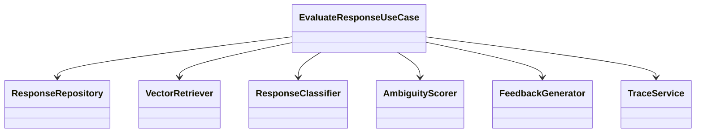

# Arquitetura

## Arquitetura em camadas

## Arquitetura em camadas — versão Mermaid original

## Decisão arquitetural

O mock usa uma Clean Architecture leve:

- `domain`: regras, entidades e contratos.
- `application`: casos de uso.
- `infrastructure`: DuckDB, vector retrieval, modelos e tracing.
- `routes/templates`: UI e API.

## Dependências do caso de uso

## Portas/interfaces da aplicação — versão Mermaid original

