# Diagramas do projeto

Esta página centraliza os diagramas renderizados em PNG em `docs/images/`.

Atualizado em `2026-06-17T19:20:20.905889+00:00`.

## Tese técnica

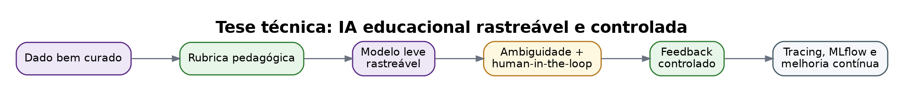

## Arquitetura em camadas

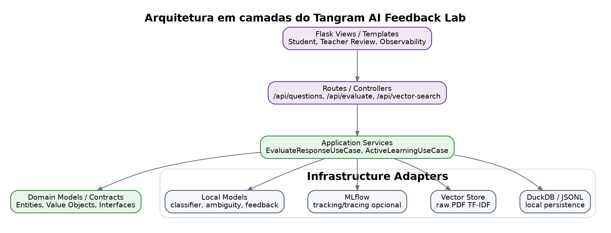

## Arquitetura em camadas — versão Mermaid original

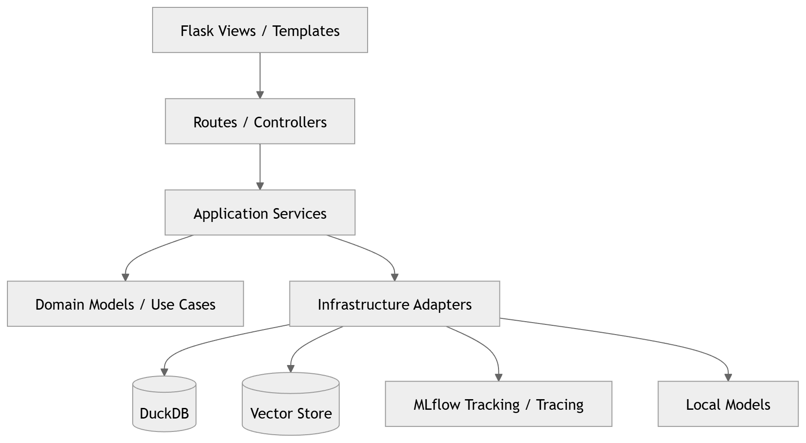

## Dependências do caso de uso

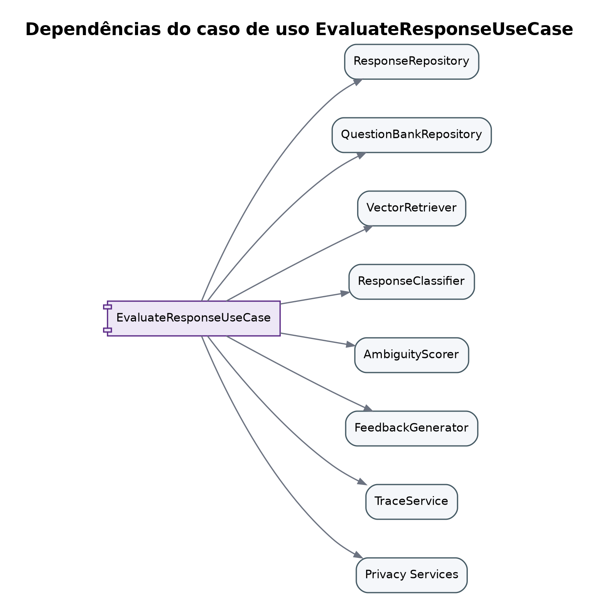

## Portas/interfaces da aplicação — versão Mermaid original

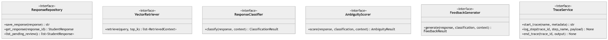

## Workflow de resposta do estudante

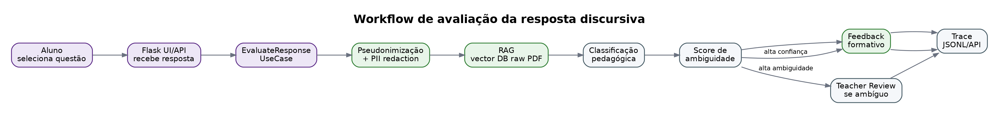

## Sequência completa de resposta do estudante — versão Mermaid original

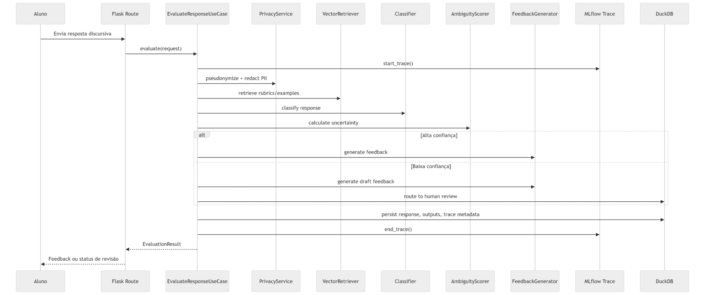

## Workflow de active learning

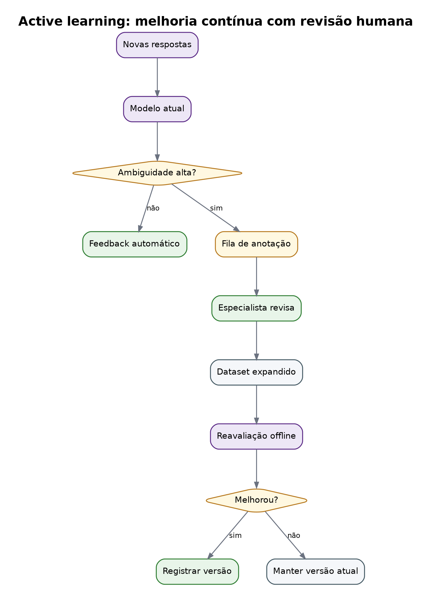

## Modelo de dados conceitual

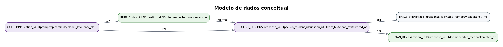

## Human-in-the-loop

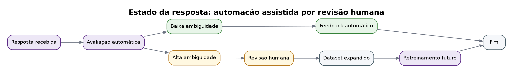

## Trace de avaliação

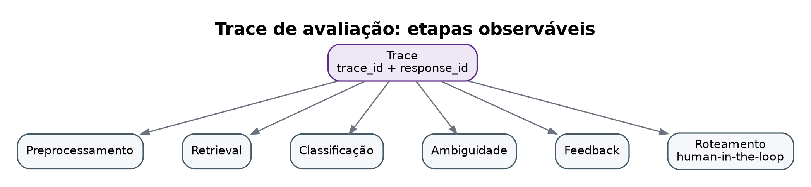

## MLflow Experiments e Traces — versão Mermaid original

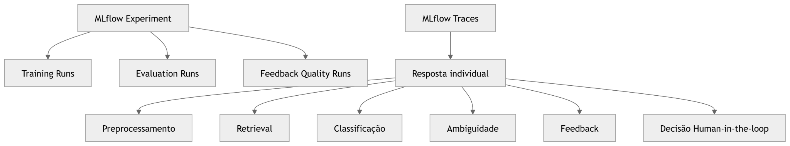

## Privacidade by design

## Roadmap até TRL 4

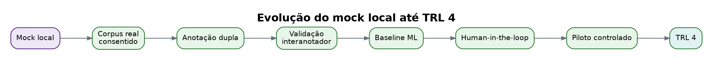

## Vector retrieval seed/fallback

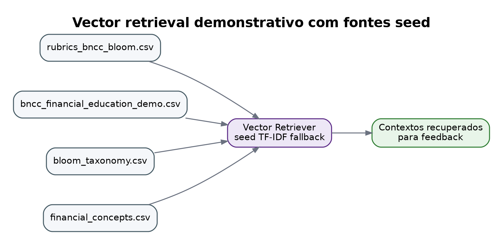

## Pipeline de fontes originais

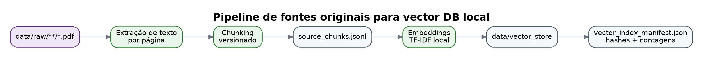

## MVP técnico ponta a ponta

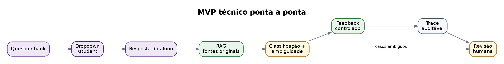

## Mapa de rotas/API

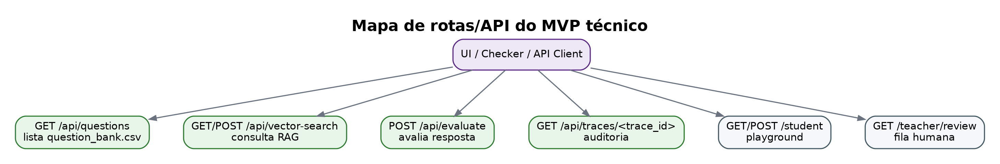
