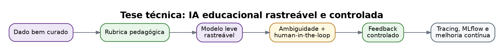
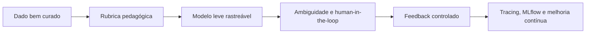

# Tangram AI Feedback Lab

Este mock demonstra uma suíte completa, porém não produtiva, para avaliação discursiva com IA em educação financeira.

## Tese técnica

A solução não deve ser uma chamada genérica para LLM. Ela deve ser uma esteira rastreável:

## Paleta

- Anotação/revisão: roxo suave, cinza e branco.
- Gamificação: roxo + verde com baixa saturação.
- Alertas: amarelo queimado e vermelho suave.
