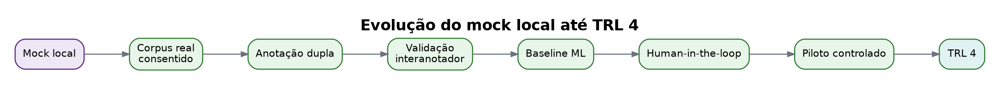
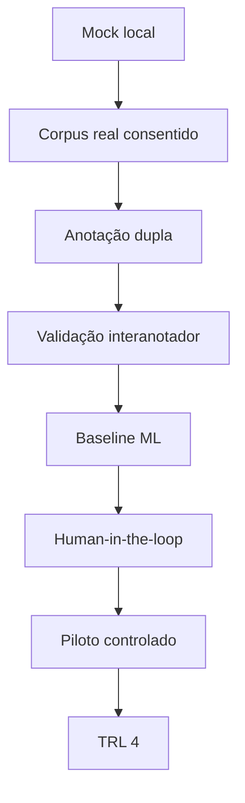

# Limites do mock

Este pacote não é produtivo.

## Limitações principais

- Dados sintéticos.
- Classificador baseado em regras.
- Rubricas simplificadas.
- Sem autenticação.
- Sem controle de acesso real.
- Sem avaliação formal de fairness.
- Sem teste de carga.
- Sem consentimento real.

## Próximos passos produtivos

