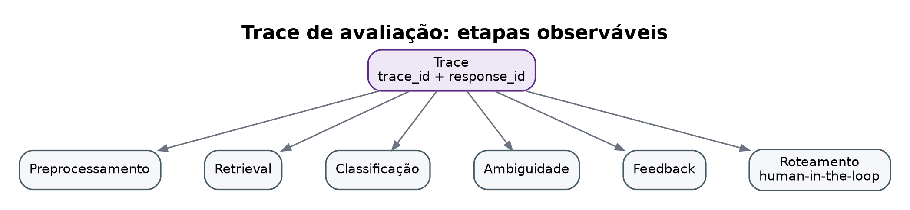
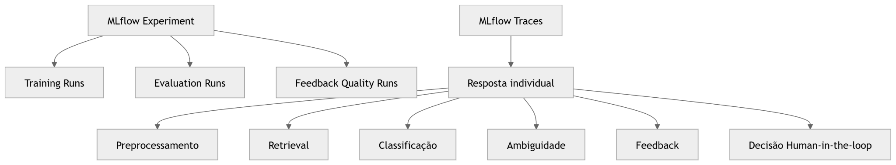

# MLflow Tracking e Tracing

## Trace de avaliação



## MLflow Experiments e Traces — versão Mermaid original



## Interpretação

O mock separa dois tipos de rastreabilidade:

1. **Experimentos**: runs de treino, avaliação e qualidade de feedback.
2. **Traces**: rastreabilidade de uma resposta individual.

A resposta individual deve registrar etapas como:

```text
preprocessamento
retrieval
classificação
ambiguidade
feedback
decisão human-in-the-loop
```

Em produção, esses traces podem ser integrados a MLflow Tracing, OpenTelemetry ou outro backend de observabilidade.
