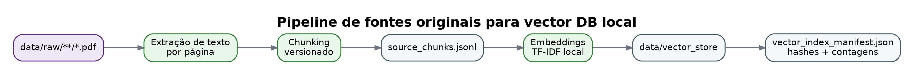
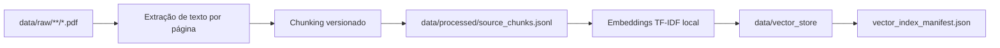

# Pipeline com fontes originais

Este pipeline transforma PDFs oficiais em uma base vetorial auditável.





## Entradas

Coloque PDFs oficiais em:

```text
data/raw/
  bncc/
  mec_tct/
  bcb/
```

## Comando

```bash
python scripts/build_raw_pdf_vector_db.py \
  --raw-dir data/raw \
  --processed-dir data/processed \
  --vector-dir data/vector_store \
  --chunk-size 900 \
  --chunk-overlap 150 \
  --pipeline-version raw_pdf_tfidf_v1.0
```

## Saídas

```text
data/processed/source_pages.jsonl
data/processed/source_chunks.jsonl
data/vector_store/indexed_chunks.jsonl
data/vector_store/tfidf_vectorizer.joblib
data/vector_store/tfidf_matrix.npz
data/vector_store/vector_index_manifest.json
```

## Consulta rápida

```bash
python scripts/query_raw_vector_db.py "educação financeira consumo consciente" --top-k 5
```

## Observação

O backend padrão é TF-IDF local para manter o mock leve, reproduzível e executável em CPU. Para produção, substitua por Chroma, FAISS, pgvector, Qdrant ou serviço gerenciado.
