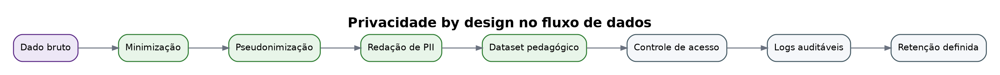
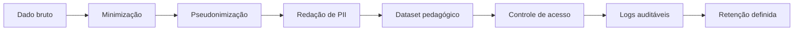

# Privacidade by design

Princípios:

- Não enviar nome do estudante ao modelo.
- Separar dado pessoal de dado pedagógico.
- Mascarar PII em texto livre.
- Registrar consentimento e finalidade.
- Versionar dados, rubricas e modelos.
