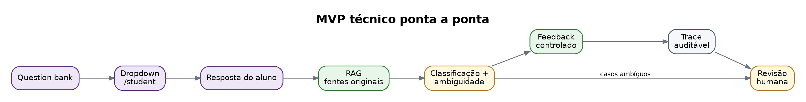
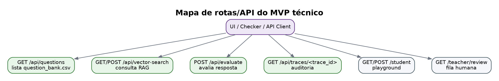

# MVP técnico

Esta página resume os dois diagramas adicionais do MVP técnico local.

## Fluxo ponta a ponta



## Mapa de rotas/API



## Critério de prontidão

O MVP técnico está pronto para demo local quando o checker retorna `READY for technical MVP demo` e as rotas principais estão registradas:

```bash
python -m flask --app app routes
python scripts/check_mvp_technical.py --base-url http://127.0.0.1:5000
```
