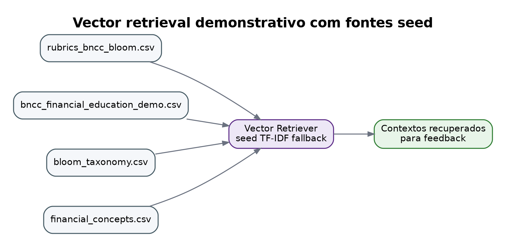
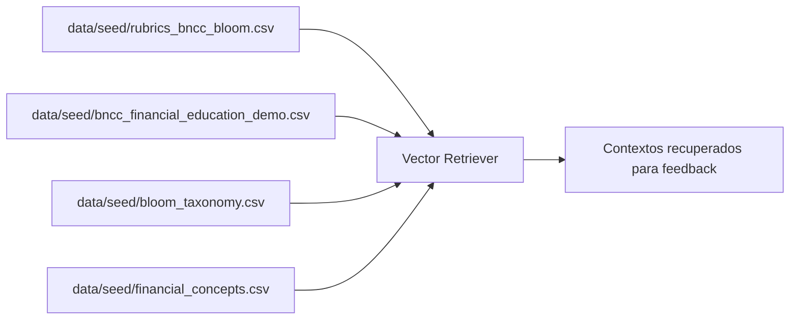

# Vector database: BNCC, Bloom e rubricas

> Esta página descreve o repositório vetorial seed/fallback. Para o pipeline com PDFs originais, veja também [Pipeline com fontes originais](original_source_pipeline.md).

O mock usa `SimpleTfidfVectorRepository` para manter a demo leve. Mesmo assim, a estrutura foi desenhada como se fosse substituir por ChromaDB, FAISS, Qdrant ou pgvector.

## Fontes indexadas





## Observação importante

Os arquivos BNCC incluídos são **recortes demonstrativos e sintéticos**. Eles não substituem a BNCC oficial nem uma curadoria pedagógica real. Em uma implantação real, o fluxo correto seria:

1. Curar os trechos oficiais/validados.
2. Versionar fonte, data e responsável pedagógico.
3. Quebrar os documentos em chunks rastreáveis.
4. Gerar embeddings.
5. Persistir os embeddings no vector DB.
6. Registrar `source_id`, `version`, `chunk_id` e metadados no trace.

## Manifesto local

Rode:

```bash
python scripts/build_vector_store.py
```

Isso cria:

```text
data/vector_store/vector_index_manifest.json
```

O manifesto mostra os arquivos indexados, contagens e exemplos de recuperação.
